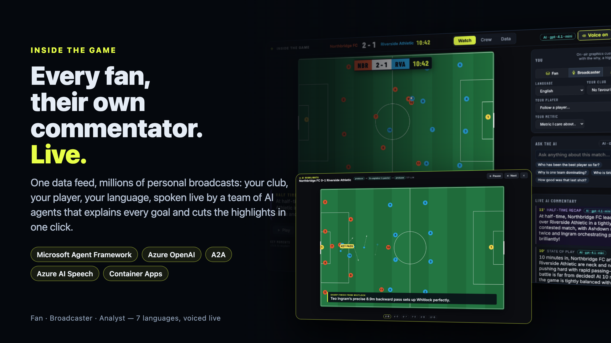
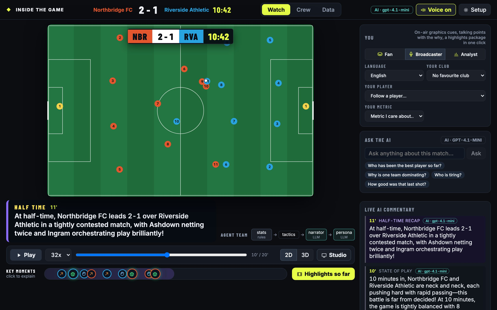
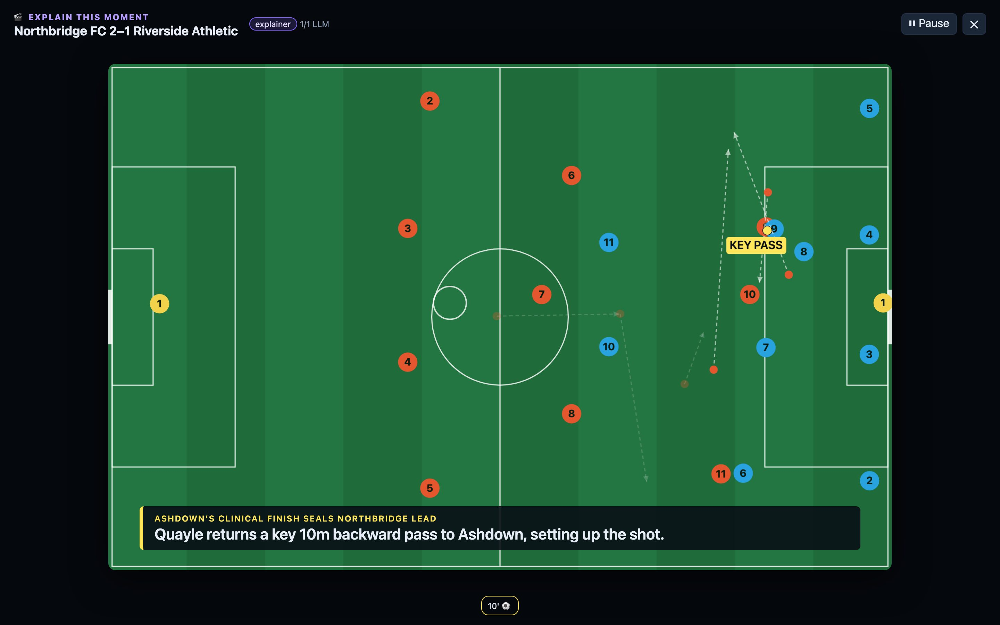
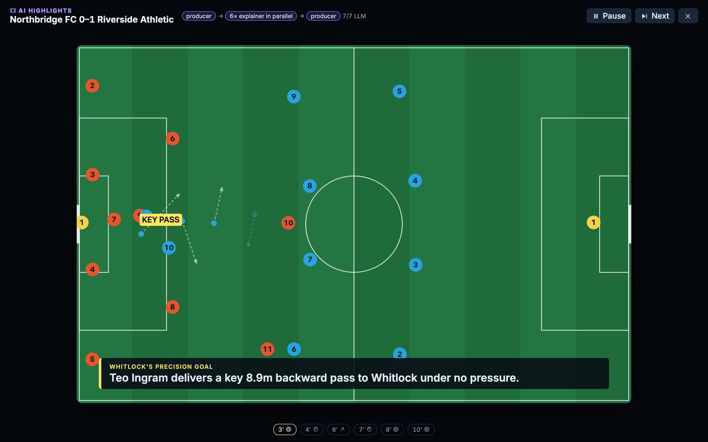
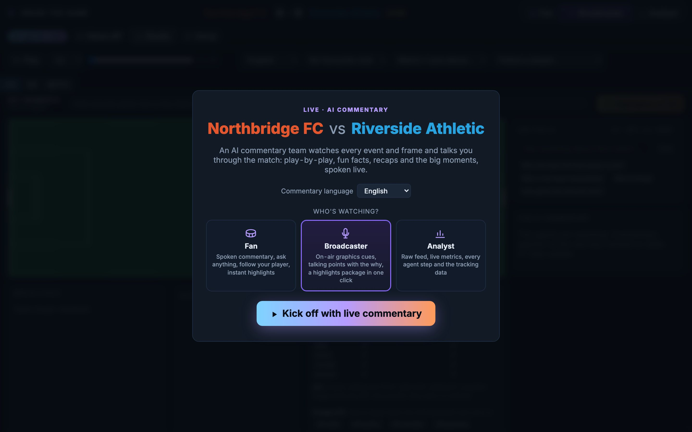
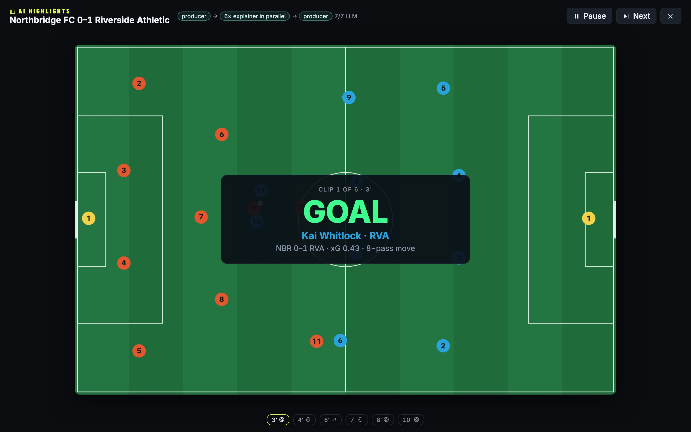
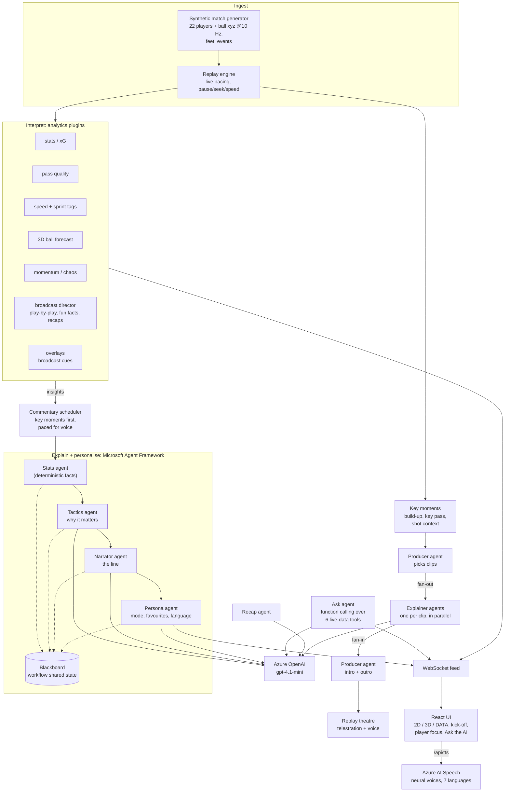

# Inside the Game: Match Intelligence



Hackathon project for **Microsoft + Premier League "Inside the Game"**. It turns synthetic football data into
live, explainable match intelligence: stats derived from raw data, a bird's-eye view, a 3D ball-flight
forecast, and a multi-agent narrator that writes for each viewer.

**Live demo:** https://insidethegame.delightfulforest-cce043aa.swedencentral.azurecontainerapps.io
(Azure Container Apps + `gpt-4.1-mini` on Azure OpenAI. Try Analyst mode, Türkçe, or "Follow a player".)



| Explain this moment: telestrated replay, analyst voice | AI highlights: producer + explainers in parallel |
|---|---|
|  |  |
|  |  |

What to try:
- **Explain this moment:** every shot and goal lands on the key moments timeline. Click one and the explainer agent
  replays it like a TV analyst at the telestrator: the move is drawn from tracking (how the ball was won, the passes,
  the key pass and how many defenders it took out, the space at the shot), the replay freezes on each beat and the
  analyst says it out loud, in the viewer's language.
- **🎬 Highlights so far:** an automated highlights package of the match up to the live clock. The producer agent
  ranks the moments, one explainer per clip runs in parallel, the producer writes the intro and outro, and the reel
  plays narrated with clip cards and slow motion at the shot.
- **Metric I care about:** pick one performance metric (sprint distance, completed passes, xG, pressures, top speed
  or distance). A live ranking of every player on it stays on screen, and the commentary keeps that number in: a
  goal line also says the scorer's sprint distance so far.
- **Fan / Broadcaster / Analyst:** who is watching sets the commentary style and the screen (fans get voice, Ask
  and highlights; broadcasters get talking points with the why, graphics cues and the agent panel; analysts also
  get the raw-data tab). Match and plugin controls live under **⚙ Setup**.
- **DATA tab:** the raw feed made visible. Live throughput (messages/s, KB/s), xG race, possession, momentum and
  ball-speed charts building second by second, a 22-player tracking table (position, live speed, foot heights)
  and the event stream as it arrives.
- **Ask the AI:** ask anything about the match in any language ("who is tiring?", "why are they dominating?").
  An agent with function calling picks live-data tools (`get_match_state`, `get_player`, `get_team_stats`,
  `get_recent_events`, `get_top_players`, `get_ball_forecast`) and answers only from what they return. The tools
  it used are shown under each answer.
- **🔈 Voice commentary:** turn it on in the header and the AI commentary and answers are spoken live by an
  Azure AI Speech neural voice in the viewer's language (en, tr, es, fr, de, pt, ar), with more energy on goals.
- **Broadcast director:** watches every event and frame and briefs the narrator every few seconds: play-by-play
  of what's on screen (who has the ball, where, the current passing move), fun facts as they happen (longest
  move, fastest shot, braces, headers, weak-foot goals, saves, distance milestones) and running, half-time and
  full-time recaps. Key moments always go first. In Analyst mode, each line shows the brief the narrator got.
- **Live AI commentary:** every line is written by the agent team (labelled with the model), including
  "state of play" updates every two match minutes.
- **Agent team · live:** the orchestration on screen. Each line lights up its run through stats → tactics →
  narrator → persona with the path each agent took (rules, LLM, skipped, fallback) and its latency, running
  totals per agent, and the tools the Ask agent called for the last question.

## Architecture



Every agent runs with a timeout and a deterministic template fallback, and each narration carries a trace of
which agent ran, by which path and how long it took. Everything runs in one Azure Container Apps container.

**Tracing:** with `APPLICATIONINSIGHTS_CONNECTION_STRING` set, each narration, agent step (path, fallback,
latency), Ask question, tool call and voice request is an OpenTelemetry span in Azure Application Insights, with
the Azure OpenAI and Speech calls as child dependencies (`app/telemetry.py`). Unset, tracing is off.

### The brief, item by item

| Brief asks for | Where it is |
|---|---|
| Ingest live synthetic events and metadata | Replay engine paces stored frames and events like a live feed (`WS /ws/live`) |
| Player identification: name tags, speed/distance thresholds | `speed_metrics`: tags at 25 km/h sprints and at each kilometre covered, drawn on the pitch |
| Pass quality: distance, accuracy, difficulty rating | `pass_quality` plugin (length, pressure, weak foot, progression) |
| Speed metrics: ball speed, shot speed | `speed_metrics`: live ball speed, every shot's speed, fastest shot called |
| Auto-eventing | Speed, distance, sprints, fatigue and ball speed computed from raw tracking, not tagged events (no video in the data) |
| Narrative generation: narratives, player context, milestones, recaps | Director briefs → agent chain; player-focus mode; half/full-time recaps; highlights package |
| Explainability: control vs chaos, pressure changes, rhythm | `momentum` plugin (chaos index, swings), tactics agent, explain-this-moment telestration |
| Render: on-screen, timed machine-readable overlays | 2D/3D views, replay theatre, `GET /api/matches/{id}/overlays` cue timeline |
| Personalise: modes, favourite club/player, player-focused mode, a single metric a viewer cares about, language | Fan / Broadcaster / Analyst, casual/tactical, favourites, follow-a-player camera, **Metric I care about** (live ranking + commentary keeps that number), 7 languages voiced |
| Data innovation | Own generator: 3D ball, foot positions, headers, fatigue, full event stream, any seed/length |

Maps to the hackathon's 5 stages: **ingest** (replay) → **interpret** (plugins, key moments) → **explain**
(tactics and explainer agents, telestrated replays) → **render** (2D/3D, broadcast cues, replay theatre, highlights)
→ **personalize** (persona agent and Fan / Broadcaster / Analyst modes: style, favourite club/player, language).

**Running in production:** live narrations, explanations and highlights clips are cached per moment and persona,
so repeat viewers reuse them (and their audio) instead of calling the model again; after a restart the app
pre-builds the English replays in the background (`PREWARM=0` turns it off). The paid endpoints (voice,
explain/highlights/recap, Ask) are rate-limited per client (`app/ratelimit.py`).

## Run

Backend (Python 3.11+):

```bash
cd backend && uv venv --python 3.12 .venv && uv pip install --python .venv/bin/python -e ".[dev]"
```

```bash
cd backend && .venv/bin/uvicorn app.main:app --port 8000
```

On first start it generates a 20-minute match (seed 2, an eventful 2-2), about 5 s, and caches it in
`backend/data/`. `MATCH_SEED` / `MATCH_MINUTES` env vars change the default. The **New match** button in the
UI (or `POST /api/matches {"seed": 11, "minutes": 90}`) generates another; a 90-minute match takes about 25 s.
Players tire over a match (sprint speed drops late on); the stats plugin detects it from tracking alone.

Frontend (Node 20+):

```bash
cd frontend && npm install && npm run dev
```

Open http://localhost:5173.

Tests:

```bash
cd backend && .venv/bin/python -m pytest -q
```

### Enable the LLM (Microsoft Foundry / Azure OpenAI)

Without these env vars, every agent uses its deterministic template path (works offline, English only).

Copy `backend/.env.example` to `backend/.env` and fill in endpoint, deployment and key. Check the
deployment live (raw completion, then en/tr/es narrations with the agent trace):

```bash
cd backend && .venv/bin/python scripts/check_foundry.py
```

Then start the backend with the same file: `.venv/bin/uvicorn app.main:app --port 8000 --env-file .env`.

### Deploy (single container)

The `Dockerfile` builds the React app and serves it from FastAPI, so one container hosts the UI, REST and
WebSocket. On Azure Container Apps (builds in the cloud, no local Docker needed):

```bash
az containerapp up --name insidethegame --resource-group <rg> --location <region> --source . --ingress external --target-port 8000
```

Keep the model key out of the image: store it as a Container Apps secret and reference it.

```bash
az containerapp secret set -n insidethegame -g <rg> --secrets aoai-key=<key> appinsights-conn=<connection-string>
```

```bash
az containerapp update -n insidethegame -g <rg> --min-replicas 1 --set-env-vars AZURE_OPENAI_ENDPOINT=<endpoint> AZURE_OPENAI_DEPLOYMENT=gpt-4.1-mini AZURE_OPENAI_API_KEY=secretref:aoai-key APPLICATIONINSIGHTS_CONNECTION_STRING=secretref:appinsights-conn
```

To ship a new version: `az acr build -r <registry> -t insidethegame:<tag> .`, then
`az containerapp update -n insidethegame -g <rg> --image <registry>.azurecr.io/insidethegame:<tag>`.

## Data

Each tracking frame (10 Hz) holds the ball `(x, y, z)`, every player's `(x, y)`, and **leg data**: left and
right foot `(x, y, z)` from a gait model (stride length and cadence scale with speed, the swing foot
lifts, the striking foot is planted on the ball at a kick). Every player has a `preferred_foot`, and every
pass and shot records `body_part` (`left_foot` / `right_foot`) and `weak_foot`. Weak-foot kicks are less
accurate and rate harder in pass difficulty. Crosses are lofted and attackers head them when the ball drops
through head height (`body_part: head`), so headed passes, shots and goals appear in the feed.

Broadcast cues: `GET /api/matches/{id}/overlays` returns the full timeline of graphics cues
(`t_in`, `t_out`, `slot`, `template`, data) for a graphics engine to sync against the match clock.

## Layout

| Path | What |
|---|---|
| `backend/app/physics.py` | Ball physics (gravity, drag, Magnus, bounce, rolling friction), shared by generator and forecast |
| `backend/app/generator/synthetic.py` | Agent-based match simulator: formations, pressing, passes, shots, tackles, restarts |
| `backend/app/replay.py` | Paces stored frames like a live feed (pause / seek / 0.1x–32x) |
| `backend/app/pipeline.py` | Runs enabled plugins per frame; toggling a plugin on catches it up on the match so far |
| `backend/app/plugins/` | `stats`, `pass_quality`, `speed_metrics`, `ball_forecast`, `momentum`, `director` (broadcast briefs), `overlays` |
| `backend/app/commentary.py` | Commentary scheduler: key moments first, routine briefs paced for a voice, stale play dropped |
| `backend/app/agents/` | Microsoft Agent Framework agents: live chain (`stats` → `tactics` → `narrator` → `persona`) as a workflow over a shared blackboard; `ask_agent` (function calling), `explain_agent` (explainer + producer), `recap_agent`; `llm.py` holds the Foundry client |
| `backend/app/moments.py` | Key moments from events + tracking: build-up, key pass, shot context, replay windows |
| `backend/app/speech.py` | Azure AI Speech neural voices per language, cached |
| `backend/app/telemetry.py`, `ratelimit.py` | OpenTelemetry to Application Insights; per-client limits on paid endpoints |
| `backend/app/main.py` | REST + `WS /ws/live/{match_id}`; `/moments`, `/moments/{id}/explain`, `/highlights`, `/recap`, `/tts` |
| `frontend/src/` | React app: `Pitch2D` (canvas), `Ball3D` (react-three-fiber), `ReplayTheater` (telestrator), `MomentsBar`, `AgentOps`, `AskPanel`, `DataView`, audience modes |

### Add a plugin

1. Subclass `Plugin` in `backend/app/plugins/<name>.py` (`on_event` → insights, `on_frame` → UI payload).
2. Add it to `PLUGIN_CLASSES` in `backend/app/plugins/__init__.py`.

It shows up as a toggle in the UI automatically. Its payload arrives under `tick.plugins.<name>`.

### A2A: call the match analyst from another agent

The match analyst is also an **A2A (Agent2Agent)** agent, so a broadcaster's own agent or studio tool can use it
directly. Discover it from its card and send it a message over JSON-RPC:

- Card: `GET /.well-known/agent-card.json` (skills: `ask`, `explain`, `highlights`)
- Endpoint: `POST /a2a`

```python
import asyncio, httpx
from a2a.client import A2ACardResolver
from agent_framework.a2a import A2AAgent

async def main():
    async with httpx.AsyncClient(timeout=60) as http:
        card = await A2ACardResolver(http, "https://insidethegame.delightfulforest-cce043aa.swedencentral.azurecontainerapps.io").get_agent_card()
        analyst = A2AAgent(agent_card=card, http_client=http)
        print((await analyst.run("Explain the 8th-minute goal")).text)

asyncio.run(main())
```

It is an Agent Framework `Agent` whose chat client routes each request to the app's ask, explainer and producer
agents, served by Agent Framework's `A2AExecutor` on the official A2A SDK (`app/a2a_server.py`).

### WebSocket protocol

Server → client: `meta`, `tick {frame, events, plugins, insights}`, `narration` (with the agent `trace`),
`answer` (with the tools called), `end`, `*_ack`.
Client → server:
- `{"type":"control","action":"pause|play|seek","t":120,"speed":8}`
- `{"type":"plugins","enabled":[...]}`
- `{"type":"persona","persona":{"mode":"analyst","language":"tr","favorite_player":"h10"}}`
- `{"type":"ask","question":"Who is tiring?"}`

## Design notes

- **Agent Framework:** each LLM agent (tactics, narrator, persona, recap) is a Microsoft Agent Framework
  `Agent` with its own instructions. The live chain is an Agent Framework `Workflow`: one executor per
  agent, coordinating through the blackboard in workflow shared state. `LLMChatClient` plugs the Foundry
  transport (or a test fake) in as the agents' chat client.
- **Grounded numbers:** the stats agent is deterministic and picks the facts. LLM agents only phrase, explain
  and translate, so commentary can't invent statistics.
- **Failure recovery:** each agent has a timeout. On error or timeout its template runs instead, and the
  per-narration `trace` records which path ran. The explainer and producer ask for JSON mode, retry once on a
  malformed reply, then fall back to grounded templates; fallbacks are never cached.
- **Fan-out / fan-in:** a highlights package runs one explainer per clip in parallel (`asyncio.gather`), then the
  producer writes the intro and outro over their headlines.
- **Forecast honesty:** tracking doesn't expose spin, but the generator applies Magnus curl, so forecasts are
  scored against reality (mean position error 1 s ahead, about 0.15–0.2 m now).
- **Generator simplifications:** no offside, fouls or cards; teams don't swap ends at half time. Action is
  about 4x denser than a real match (shots, goals) to keep demos lively; about half of shots are on target.

## Next steps

- Host the agents in Foundry Agent Service (they already run on Agent Framework).
- Stream through Azure Event Hubs, store in Fabric.
- Learned models: xG, pass difficulty, spin estimation for the forecast.
- Full-body pose (knees, hips) in the limb data; compress cached matches (about 17 MB per 20 min of JSON).
- Export the highlights package as video for social clips.
